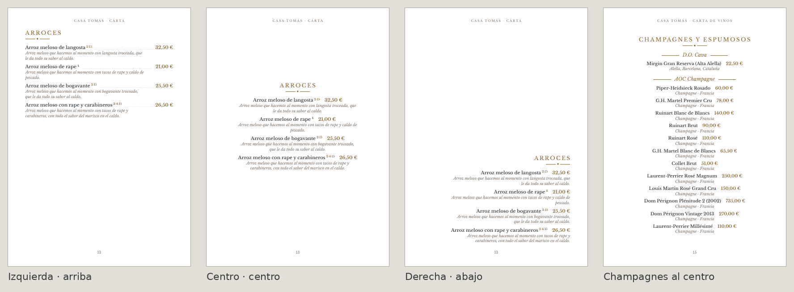
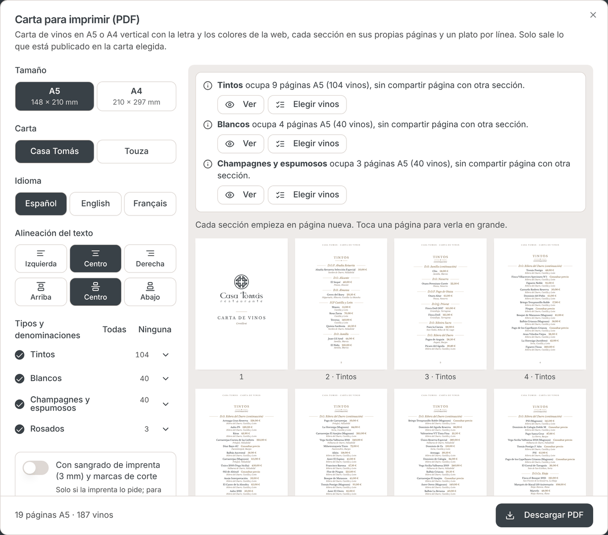

# Carta impresa (PDF)

Gestor Web › Carta › **PDF Carta**, en platos y en vinos, A5 (148 × 210 mm) o A4 (210 × 297 mm). Código: `src/lib/carta-pdf/` (maquetación y PDF) y `src/components/carta/imprimir/` (diálogo).

## Las reglas (08/11 y 10/11/2026)

- **Nunca dos secciones en el mismo folio.** Cada sección (categoría de platos o tipo de vino, en el orden de siempre) empieza en página nueva. Si no cabe en una, sigue en las siguientes, que repiten el título con «(continuación)». La siguiente sección vuelve a empezar en página nueva.
- **Un plato por línea.** Siempre a una columna: un plato o un vino debajo de otro, nunca dos al lado.
- Ningún plato ni vino se parte entre páginas, y ninguna palabra se corta por letras. Una denominación no se queda sola al pie: va con al menos dos de sus vinos, y si sigue en la página siguiente, allí se repite su nombre con «(continuación)».
- Una sección sin elementos no tiene página. No hay páginas en blanco.
- Portada y contraportada (alérgenos, IVA, contacto) se quedan como estaban.

## Alineación (se elige en el diálogo)

- **Horizontal:**
  - **Izquierda** (por defecto): el nombre a la izquierda y puntos guía hasta el precio, en el margen derecho.
  - **Centro**: cada línea centrada, con el precio detrás del nombre; en vinos, la copa va debajo.
  - **Derecha**: todo pegado al margen derecho, con el precio detrás del nombre.

  El título de la sección y las denominaciones se alinean igual.
- **Vertical:**
  - **Arriba**: el bloque (título y platos) empieza arriba de la página.
  - **Centro** (por defecto): el bloque se coloca en el centro óptico, algo por encima de la mitad.
  - **Abajo**: el bloque acaba abajo de la página.

  Se nota en las secciones cortas; una sección corta no se estira.

La cabecera («CASA TOMÁS · CARTA») y el número de página van siempre centrados y en el mismo sitio.

## Cómo se adapta a cada tamaño

Cada tamaño tiene su escalera de composiciones (`FORMATOS[...].variantes` en `maquetacion.ts`), de la de diseño a la más compacta: menos aire entre platos, márgenes algo más justos (nunca por debajo de 12 mm) y letra un poco menor. Una sección usa la primera con la que cabe en **una** página. Si no cabe en una con ninguna, no se aprieta: va con la letra de diseño en las páginas que haga falta, repartida para que queden parecidas (no una llena y la última con dos platos).

**Cuerpo mínimo:** nombres y precios de 9 pt o más, descripciones de 8 pt o más (`CUERPO_MINIMO`). El A4 no es el A5 ampliado: tiene márgenes y letra propios.

El diálogo dice qué secciones ocupan varias páginas. Desde ahí se puede ver su primera página o quitar platos o vinos solo de la carta impresa; la web no cambia. Lo quitado se ve en el diálogo y se puede recuperar.

En el caso raro de un texto tan largo que no cabe ni en una página entera, su página sale marcada y el PDF no se genera (`SeccionNoCabeError`) hasta acortarlo o quitarlo.

## Con los datos de la demo (10/11/2026, alineación por defecto)

| Carta | A4 | A5 |
|---|---|---|
| Platos (11 categorías) | 11 páginas, una por categoría | 13 páginas: *Novedades del día* y *Mariscos* ocupan 2 cada una |
| Vinos (4 tipos) | 13 páginas: *Tintos* 6, *Blancos* 3, *Champagnes* 3, *Rosados* 1 | 17 páginas: *Tintos* 9, *Blancos* 4, *Champagnes* 3, *Rosados* 1 |

(Sin contar portada ni contraportada.)

