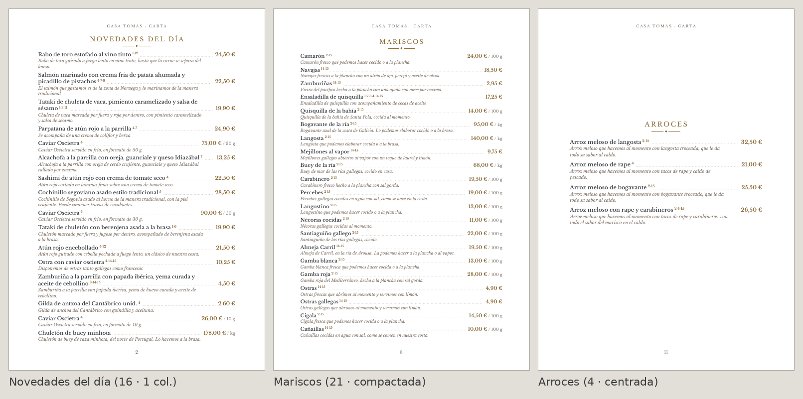
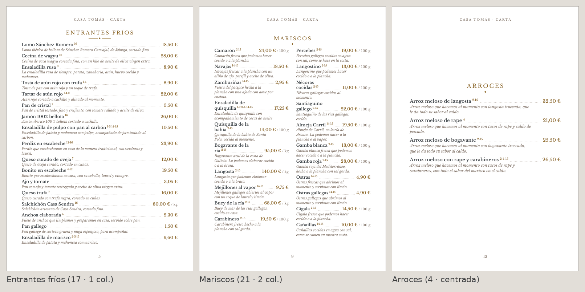
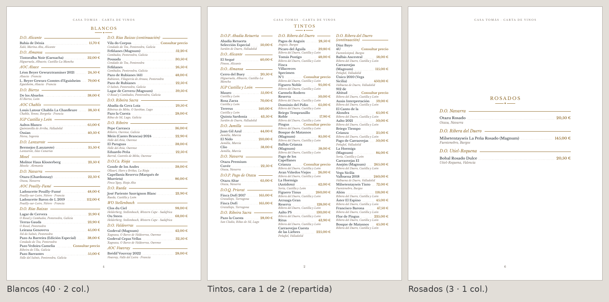
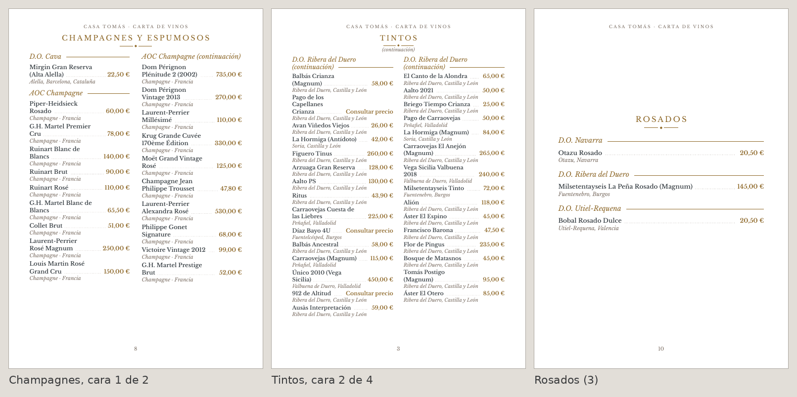
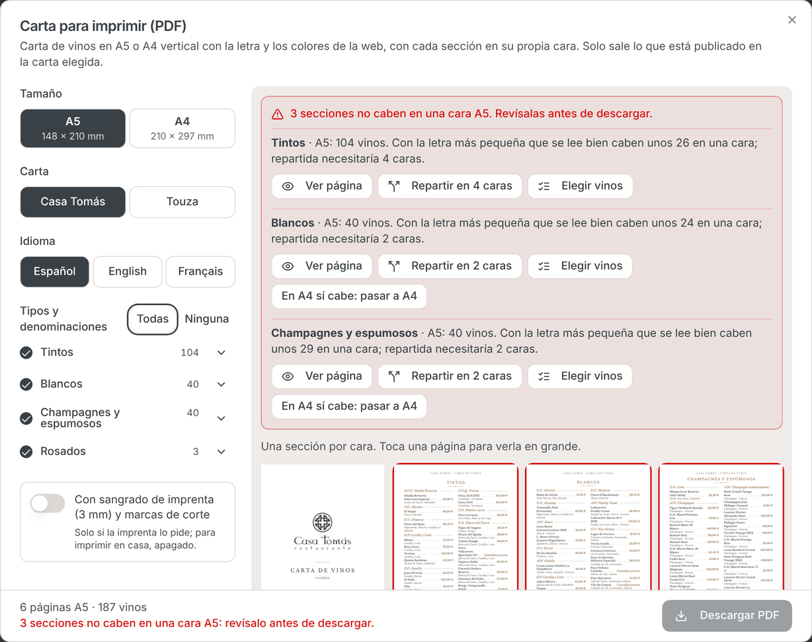

# Carta impresa (PDF): una sección por cara

Gestor Web › Carta › **PDF Carta**, en platos y en vinos, A5 (148 × 210 mm) o A4 (210 × 297 mm). Código: `src/lib/carta-pdf/` (maquetación y PDF) y `src/components/carta/imprimir/` (diálogo).

## La regla (08/11/2026)

Cada sección ocupa **una página, una cara del papel**. Si se imprime a doble cara, cada cara lleva una sección distinta.

- Las secciones son las de siempre y en el mismo orden: las categorías de platos (orden de la web) y los tipos de vino (tintos, blancos, champagnes y espumosos, rosados, otros). Dentro de un tipo de vino, las denominaciones siguen siendo sus apartados.
- Cada sección empieza en página nueva y lleva en ella todos sus platos o vinos. No se mezclan dos secciones en una página ni una sigue sola en la siguiente.
- Ningún plato ni vino se parte entre páginas, y ninguna palabra se corta por letras.
- Una sección sin elementos no tiene página. No hay páginas en blanco entre secciones.
- Portada y contraportada (alérgenos, IVA, contacto) se quedan como estaban.

## Cómo se adapta a cada tamaño

Cada tamaño tiene su escalera de composiciones (`FORMATOS[...].variantes` en `maquetacion.ts`), de la de diseño a la más compacta. Cada sección usa la primera con la que cabe entera en su cara:

1. Menos aire entre elementos.
2. Márgenes algo más justos (nunca por debajo de 12 mm) y letra un poco menor.
3. Más columnas: platos en A5 a dos columnas; vinos en A4 a dos y, para los tipos más largos, a tres. Las columnas se equilibran.

El A4 no es el A5 ampliado. Los platos van a una columna centrada con márgenes anchos, y los vinos a una columna si son pocos y, si no, a dos.

**Cuerpo mínimo:** nombres y precios de 9 pt o más, descripciones de 8 pt o más (`CUERPO_MINIMO`). Una sección corta no se estira: guarda la letra y el aire de diseño y se centra en la página.

## Si una sección no cabe

Si no cabe ni con la composición más compacta, la maquetación no corta ni oculta nada y no la reparte sola. El diálogo:

- Avisa con la sección y el tamaño, por ejemplo «Tintos · A5: 104 vinos. … caben unos 26 en una cara; repartida necesitaría 4 caras».
- Marca su página en la vista previa («No cabe»).
- No deja descargar. `crearPdfCarta` también se niega (`SeccionNoCabeError`).

Para resolverlo, sin salir del diálogo:

- **Ver página**: lo que entra con la letra mínima.
- **Repartir en N caras**: hay que elegirlo a propósito. Las caras se equilibran y cada una repite el título con «(continuación)».
- **Elegir platos/vinos**: quitar elementos solo de esta carta impresa (la web no cambia), o desmarcar denominaciones en la lista de la izquierda.
- **Pasar a A4 (o A5)**: si en el otro tamaño sí cabe.

Lo decidido (secciones repartidas, elementos quitados) se ve en el diálogo y se puede deshacer.

## Con los datos de la demo (08/11/2026)

| Carta | A4 | A5 |
|---|---|---|
| Platos (11 categorías) | Todas en su cara | Todas salvo *Novedades del día* (16): caben 14 |
| Vinos (4 tipos) | Todos salvo *Tintos* (104): necesita 2 caras | *Tintos* (4 caras), *Blancos* (2) y *Champagnes* (2) no caben |

